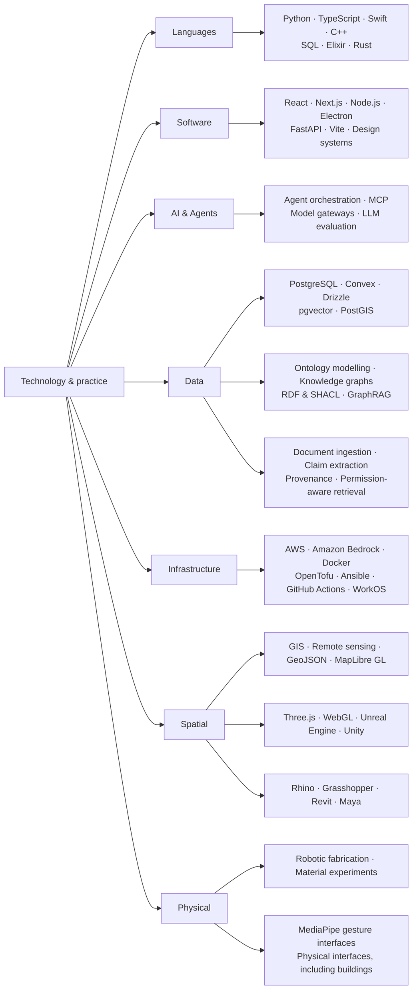

```text
 .----------------------------------------------------------.
 |  A COMMITTED GIT / KH                                    |
 |  Research / Computation / Architecture / Design / AI     |
 |  Complex systems for new technological imaginaries       |
 '----------------------------------------------------------'
      Observe --> Research --> Model --> Build --> Test
         ^                                         |
         '-----------------------------------------'
```
# Karl Herdersch

London, UK · [Personal website](https://www.karlherdersch.com/) 

I build computational and physical tools for understanding complex systems, from company knowledge and autonomous agents to buildings, cities, and infrastructure. My work connects software engineering, architecture, and experimental research for co-operation and intelligence.

At [Ironbridge](https://ironbridge.tech/), I build AI platforms and workflows that connect company knowledge, models, and data for everyday businesses.

## Current focus

- **Knowledge systems:** ontologies, knowledge graphs, provenance, and temporal models that preserve context as organisations change.
- **Autonomous systems:** agent coordination, contextual reasoning, and distributed software that can observe, anticipate, and act.
- **Spatial intelligence:** remote sensing, simulation, and interfaces for exploring physical environments.

The connecting question: how can we make complex environments easier to understand and act within, without losing their uncertainty, history, or relationships?

## Selected work

Through **[Interfacing Research Laboratory](https://www.interfacingresearchlaboratory.com/)**, I connect research with working software, spatial experiments, and physical tools.

| Project | What it explores |
| --- | --- |
| [Proximity](https://proximity.interfacingresearchlaboratory.com/en) | Organisational intelligence: connecting work, evidence, decisions, and agents. |
| [PLAYground](https://www.irlplayground.com/en-us) | Early-years learning through AI, classroom observation, and physical learning objects. |
| [Sensorium.Zone](https://www.interfacingresearchlaboratory.com/work/sensorium-think-tank) | Sensing, cognition, simulation, and digital twins. |
| [Choke Points — The Warm War](https://www.karlherdersch.com/projects/main/choke-points) | Logistics, geopolitics, and territorial dependencies through geospatial research. |
| [Models of Abandonment](https://www.karlherdersch.com/projects/main/models-of-abandonment) | The relationships between finance, architecture, infrastructure, and abandonment. |

## Tools & methods


## Open code

- [Remote Sensing Datasets](https://github.com/interfacingresearchlaboratory/remote-sensing) — geospatial analysis and environmental observation.
- [Archive Mosh](https://github.com/interfacingresearchlaboratory/archive-mosh) — procedural video collages from archival footage.

Research supplies the questions. Building systems puts them to the test.
